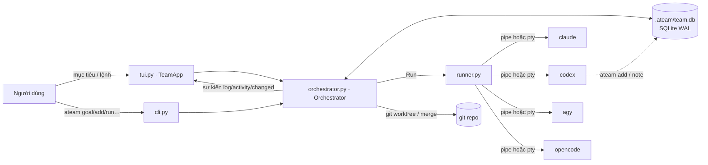
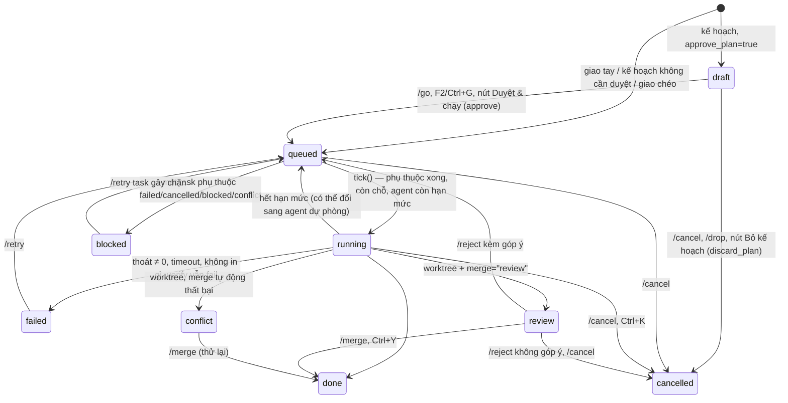

# Kiến trúc ateam

Tài liệu này mô tả ateam chạy thế nào ở mức đủ để sửa code an toàn. Tên hàm/biến khớp với code ở
phiên bản 0.3.1; nếu thấy lệch, code là chuẩn và hãy sửa tài liệu này.

## Tổng quan

- **Một vòng lặp asyncio** duy nhất (của Textual khi chạy TUI, hoặc `asyncio.run` trong CLI) chạy
  `Orchestrator.run_forever()` / `run_until_idle()`, mỗi ~0,5–0,7 giây gọi `tick()`.
- **DB là nguồn sự thật.** Trạng thái task chỉ đổi qua `DB.update_task`. TUI đọc lại DB mỗi 0,5 giây
  nên thấy cả thay đổi từ tiến trình khác (vd agent gọi `ateam add`). SQLite chạy WAL +
  `busy_timeout` để nhiều tiến trình ghi được.
- **Agent là tiến trình con** chạy headless; ateam không gọi API mô hình nào trực tiếp.

## Thực thể và trạng thái

### Task (`tasks`)

Cột đáng chú ý: `depends_on` (JSON list id), `depth` (số tầng giao chéo), `source`
(`user` | `plan` | `review` | `followup` | `cli` | `delegate:<agent>`), `model`/`effort` (ghi đè riêng task),
`branch`/`base`/`head` (worktree, dùng cho diff), `attempts` (số lần sửa sau khi verify fail),
`result` (SUMMARY đã bóc), `error`.

Hằng số trạng thái ở đầu `db.py`; `ACTIVE = (draft, queued, running, review)` — mục tiêu chưa
được review khi còn task ở các trạng thái này.

### Mục tiêu (`goals`)

`planning` → `awaiting` (có task nháp chờ /go) hoặc `running` → `reviewing` → `done` |
`incomplete` | quay lại `awaiting`/`running` với `round + 1` nếu review giao thêm việc. `failed` khi
không lập được kế hoạch. `cancelled` khi người dùng bỏ kế hoạch nháp (`discard_plan`). Khi có mục
tiêu `awaiting`, TUI hiện `PlanBar` (`#plan`, nằm ngoài các tab) cho mục tiêu chờ lâu nhất và chuyển
focus vào nút duyệt nếu ô nhập đang trống. Mục tiêu tạo từ workflow (`run_workflow`, cột `workflow`) bỏ qua `planning`:
các bước chèn thẳng qua `_insert_plan(from_user=True)` (giữ effort/model của bước); `workflow.review`
(nếu đặt) thay `auto_review` khi `_check_goals` quyết định có review không. Task giao tay (`/task`, `ateam add` ngoài agent) không thuộc mục tiêu nào
nên không được review.

**Tiếp tục** (`/continue`, F6, nút "↪ Tiếp tục", `ateam continue`): `continue_goal` mở lại mục tiêu đã
kết thúc (`GOAL_ENDED`) → `planning` với `round = 1` (giới hạn `max_rounds` tính lại), yêu cầu mới thêm vào
cột `followups` (JSON list; `Goal.full_text()` ghép `FOLLOW-UP n:` để gửi agent). `_plan(followup=…)` dùng
`followup_plan_prompt` kèm kết quả các task cũ (`_results_text`, dùng chung với review) và đánh giá trước;
task mới có `source = "followup"`. `continue_ref` bóc `m12` (mục tiêu) / `t40` (task; task thuộc mục tiêu
thì là mục tiêu đó); task không thuộc mục tiêu thì `continue_task` tạo task mới cùng agent/model/effort.

### Khác

- `notes`: ghi chú chung; 15 ghi chú mới nhất được chèn vào prompt mọi task sau, tính từ ghi chú
  `author = "compact"` mới nhất. `/compact` (`Orchestrator.compact`) gửi ghi chú + mục tiêu từ lần thu gọn
  trước + 60 dòng cuối `system.log` cho trưởng nhóm (`compact_prompt`), lấy phần sau `SUMMARY:` làm ghi
  chú `compact` mới; ghi chú cũ vẫn nằm trong DB nhưng không còn vào prompt.
- `runs`: mỗi lượt gọi agent/test một dòng (`kind` = `task` | `fix` | `lead` | `test`, `status` =
  `ok` | `failed` | `timeout` | `empty` | `ratelimit` | `cancelled`), dùng cho `/usage`.

## Vòng đời một mục tiêu

1. `new_goal(text)` → `_plan(gid)` gọi `_call_lead(plan_prompt)`.
2. `_call_lead` thử trưởng nhóm rồi lần lượt `cfg.lead_fallback`, bỏ qua agent đang cooldown; một lượt
   chạy là `_lead_once` (ghi `logs/lead.log`, `lead_spans` cho timeline).
3. `extract_json(out, list)` → `_insert_plan`: agent lạ thì giao cho trưởng nhóm; `effort` chỉ nhận
   nếu nằm trong `efforts` của agent và `lead_sets_effort`; map id cục bộ → id DB cho `depends_on`.
4. Task ở `draft` (chờ `approve`) hoặc `queued`.
5. `tick()` chạy task; khi mọi task của mục tiêu ra khỏi `ACTIVE`, `_check_goals` gọi `_review`
   (nếu `auto_review`) → JSON `{done, summary, new_tasks}` → kết thúc hoặc thêm vòng (tối đa `max_rounds`).

## `tick()` — luật lập lịch

Với mỗi task `queued` theo thứ tự id:

1. Agent không còn trong cấu hình → `failed`.
2. Có phụ thuộc lỗi (`failed`/`cancelled`/`blocked`/`conflict`/mất) → `blocked`.
3. Còn phụ thuộc chưa `done` → chờ (kể cả phụ thuộc đang `review`).
4. `paused` hoặc đã đủ `max_parallel` → chờ.
5. Agent đang cooldown → chuyển sang `pick_fallback(agent)` nếu có, không thì chờ.
6. Agent đã chạy đủ `max_concurrent` → chờ.
7. Chưa cài lệnh → `failed`.
8. Đặt `running` *ngay* (chống chạy trùng), `self.runs[tid] = None`, spawn `_run_task`.

`is_idle()` (dùng cho `ateam run`/`goal`): không có gì đang chạy, trưởng nhóm rảnh, và mọi task
`queued` còn lại đều chỉ đang chờ hạn mức hồi hoặc chờ người duyệt — để lệnh headless không treo.

## `_run_task(tid)` từng bước

1. Worktree (nếu bật): `_wt_prepare` tạo `.ateam/worktrees/t<id>` trên nhánh `ateam/t<id>` từ HEAD,
   lưu `base`.
2. Dựng prompt (`task_prompt`): mục tiêu, task, SUMMARY của task phụ thuộc, ghi chú chung, luật
   DELEGATE/NOTE/SUMMARY (chỉ cho giao chéo nếu `depth < max_delegation_depth`). Riêng task giao tay
   bằng `/task` (`source = "user"`) gửi nguyên văn `prompt` người dùng gõ, không bọc gì (vẫn đổi `@file`
   trong `argv_for`); không có DELEGATE/NOTE, `result` lấy đoạn cuối output nếu agent không in `SUMMARY:`.
   Task hỏi tiếp thread (`source = "followup"`, không thuộc mục tiêu, `parent_id` = lượt trước) dùng
   `thread_prompt`: tối đa 6 lượt trước (prompt + result, đi ngược `parent_id`) rồi yêu cầu mới.
3. Nếu có verify và `only_when_changed`: lấy `_fingerprint` (HEAD + `git diff HEAD` + file chưa track).
4. `_run_agent(kind="task")` → `Run` → phân loại `_classify`: cancelled / timeout / ratelimit / failed
   / empty / ok.
5. `ratelimit`: `_set_cooldown`, chọn agent dự phòng, task quay về `queued`.
6. Vòng verify: nếu không đổi file thì bỏ qua; chạy `/bin/sh -c <command>` trong thư mục task;
   fail thì `fix_prompt` (kèm 120 dòng cuối) cho `fix_agent` hoặc chính agent đó, tối đa
   `max_fix_attempts`.
7. Ghi NOTE vào `notes`; SUMMARY của lượt đầu (+ tóm tắt lượt sửa) vào `result`.
8. Worktree: `_wt_finish` commit nhánh, xoá worktree, rồi merge tự động (`--no-ff`, có khoá
   `_merge_lock`) hoặc để `review`. Nhánh rỗng bị xoá; nhánh lỗi được giữ để xem.
9. `done` → `_delegations` tạo task cho các khối DELEGATE (tối đa 5/task). Ở chế độ review, việc này
   hoãn tới lúc `/merge` (đọc lại từ log task).

## Chạy tiến trình (`runner.Run`)

- `stdin` là `/dev/null` (hoặc pty), `start_new_session=True` để huỷ cả cây tiến trình bằng
  `killpg` (SIGTERM, 5 giây sau SIGKILL).
- `pty=True`: mở pseudo-terminal 220×50 — cần cho `agy`, vốn không in gì khi stdout không phải tty.
- Mỗi dòng qua `clean_line`: bỏ mã ANSI, xử lý `\r` (spinner), bỏ ký tự điều khiển.
- Timeout bằng `asyncio.wait_for`; mã 124 khi quá giờ.

## Dựng lệnh agent (`AgentConfig.argv`)

`command` chứa `{prompt}` (không có thì prompt được nối cuối). Nếu có model/effort và `command` không
tự chứa `{model}`/`{effort}`, `model_args`/`effort_args` được chèn **ngay trước** phần tử chứa
`{prompt}` — hoặc trước `-p`/`--print`/`--prompt` nếu cờ đó đứng ngay trước prompt (vài CLI dùng Go
`flag`, dừng đọc cờ ở đối số vị trí đầu tiên). Placeholder rỗng bị bỏ cùng cờ đứng trước nó.
Thứ tự ưu tiên: model/effort riêng task > `state.json` (đặt trong app) > file cấu hình > mặc định CLI.

## Nhắc file bằng `@` (`mentions.py`)

Dạng chung trong prompt (người dùng gõ, TUI chèn, trưởng nhóm có thể chép vào task): `@đường/dẫn`,
có dấu cách thì `@"đường dẫn"`. `Orchestrator.argv_for` gọi `mentions.render` ngay trước khi chạy
agent (cả lượt trưởng nhóm lẫn task/sửa lỗi): mỗi lần nhắc mà đường dẫn có thật (so với thư mục
task, rồi gốc dự án) được viết lại theo `file_ref` của agent, và `file_args` (vd `-f <path>` của
OpenCode) được chèn trước prompt bằng `mentions.insert_args`. DB luôn giữ dạng chung, nên đổi người
làm (`/assign`, dự phòng hạn mức) vẫn ra đúng cú pháp của người mới.

TUI: `CommandInput` (con của `Input`) dò `@…` ngay trước con trỏ ở mỗi `Input.Changed`, lọc
`FileIndex` (`git ls-files -co --exclude-standard`, không phải repo git thì `os.walk` bỏ thư mục rác;
làm mới tối đa 20 giây/lần, chạy bất đồng bộ) và hiện `MentionList` (OptionList nổi trên lớp
`overlay`). Khi danh sách mở, ↑↓/Tab/Enter/Esc thuộc về nó; khi đóng, Enter gửi lệnh và Tab chuyển
focus như cũ.

### Ảnh (`clipboard.py`)

Terminal không gửi ảnh khi dán (Cmd+V chỉ có chữ), nên Ctrl+V trong `CommandInput` (đè `paste` của
`Input`) gọi `clipboard.grab_image`: macOS dùng `pngpaste` nếu có, không thì `osascript` (PNG trong
clipboard, hoặc file ảnh copy từ Finder thì dùng thẳng file đó); Linux dùng `wl-paste`/`xclip`. Ảnh lưu
ở `.ateam/images/paste-<giờ>.png` (xoá ảnh cũ hơn 7 ngày) rồi chèn `@.ateam/images/…` vào ô nhập.
Không có ảnh thì dán chữ trong clipboard nội bộ của Textual như Ctrl+V cũ, hoặc báo lý do. Kéo-thả
file ảnh vào terminal là một sự kiện `Paste` chứa đường dẫn (thoát dấu cách bằng `\` hoặc trong nháy):
`_on_paste` đổi thành `@ảnh`.

Từ đó ảnh đi đúng đường `@file`. `render` dùng `image_args` (mặc định `mentions.IMAGE_ARGS`; vắng thì
như `file_args`) thay `file_args` cho đường dẫn có đuôi ảnh: Codex nhận `--image=<path>` (dạng có `=`
vì `-i` nhận nhiều giá trị, sẽ nuốt luôn prompt), OpenCode `-f`, Claude/agy đọc `@path` trong prompt.
Đường dẫn tương đối không có trong thư mục làm việc (worktree không có `.ateam/`, vì git bỏ qua) nhưng
có ở gốc dự án được đổi sang tuyệt đối.

## Hạn mức

`limits.looks_rate_limited(output, rc)` chỉ xét khi agent thất bại hoặc in ≤ 15 dòng (tránh nhầm
với code nói về "rate limit"), tìm mẫu trong 30 dòng cuối. `reset_time` đọc giờ hồi từ
`|<epoch>` (Claude), `try again in N minutes`, `resets at 3pm`; không có thì `cooldown_minutes`.
Cooldown lưu ở `~/.config/ateam/state.json` (`cooldown`), dùng chung mọi dự án.

## Lệnh terminal (`!lệnh`)

`shell.ShellManager` (một instance trong `TeamApp`, tách khỏi Orchestrator — lệnh của người dùng không phải
task): mỗi `!lệnh` là một `ShellJob` chạy `$SHELL -lc <lệnh>` qua `Run(use_pty=True, timeout=10 ngày)` trong
thư mục dự án, ghi `.ateam/logs/sh<id>.log`, giữ 5000 dòng cuối trong bộ nhớ, bắt port bằng `PORT_RE`.
Sự kiện `on_event("line"|"exit"|"changed", job, line)` → `TeamApp.on_shell_event` vẽ tab Terminal (`#jobs`,
`#job-log` qua `LogStyler(task_headers=False)`). `action_quit` gọi `stop_all()` (killpg) trước khi thoát.
Gợi ý `!` (`CommandInput` chế độ `shell`) lấy từ `shell.project_scripts`; lệnh gần đây ở `recent_commands`
trong `.ateam/state.json` của dự án. Enter chạy lệnh đã gõ, chỉ chạy gợi ý khi ô trống hoặc đã ↑↓ chọn.

## Xem diff

`Orchestrator.diff_files(tid)` chạy `git -c core.quotePath=false diff -M --no-color` (worktree: `base..head`
của task; shared: `HEAD` + file chưa track từ `git ls-files --others`, bỏ `.ateam/`, file > 1 MB) và
`diffview.parse_unified` bóc thành `FileDiff`/`Hunk`/`DiffLine` có số dòng cũ/mới. `DiffScreen` (`tui.py`)
vẽ từng file bằng `diffview.render`: hai cột ghép dòng xoá ↔ dòng thêm theo khối (`split_rows`), tô cú pháp
cả khối mỗi phía một lần rồi tách dòng, chữ đổi so theo từ (`word_spans`); tối đa 4000 dòng mỗi file.
Phím `o`: `diff_versions` ghi hai bản ra `.ateam/diff/t<id>/old|new/` (`git show`) rồi chạy `code --diff`.
`Orchestrator.diff()` dạng chữ vẫn dùng cho `ateam diff`.

## Giao tiếp với TUI

`Orchestrator.emit(kind, **data)` gọi `on_event` đồng bộ trong cùng vòng lặp:

| kind | data | TUI làm gì |
| --- | --- | --- |
| `log` | `task_id` (0 = hệ thống), `line`, `agent?`, `raw?` | ghi vào log đang xem và ô agent |
| `activity` | `agent`, `start` hoặc `end` (dict: task_id, title, label, started, lines, last_line, last_at, status) | vạch ▶/■ trong ô agent |
| `changed` | — | hẹn vẽ lại sau 150 ms (`schedule_refresh`: nhiều sự kiện liền nhau thành một lần vẽ) |

`self.activity[agent]` giữ các hoạt động đang chạy (nhiều nếu `max_concurrent > 1`); `lead_spans`
cho timeline. TUI chỉ đọc hai cấu trúc này, không sửa.

### Hiệu năng vẽ (TUI)

- `refresh_view` (mỗi 0,5 giây và sau `changed`) đọc DB **một lần** (`self._snap`: tasks, goals) cho mọi
  `_refresh_*`; chỉ vẽ tab đang mở (bảng việc / Đội / Terminal), chuyển tab thì vẽ ngay
  (`on_tabbed_content_tab_activated`). `set_static()` chỉ gọi `Static.update` khi nội dung đổi.
- Lướt bảng: `RowHighlighted` đổi `view_task` + ô chi tiết ngay, còn nạp log hẹn 120 ms (chỉ dòng dừng lại).
  `show_task` đọc ~192 KB cuối file (`read_log_tail`) và hiện `LOG_SHOW_LINES` dòng cuối; `#detail` cao cố định
  để đổi task không làm tính lại bố cục cả màn hình.
- `animation_level = "none"`: không có hiệu ứng gạch chân tab trượt / cuộn mượt.
- `ReflowLog` (thay `RichLog`): giữ nội dung đã ghi, đổi bề rộng thì vẽ lại — RichLog vẽ dòng theo bề rộng lúc
  ghi, nên log ghi khi cột hẹp (1–2 ký tự) thành chữ dọc mãi. Dưới `NARROW_WIDTH` (110) cột, `#board` thêm
  class `narrow` và xếp dọc.

### Popup (`BaseModal`)

Mọi `ModalScreen` kế thừa `BaseModal`: dòng tiêu đề có nút ✕ (`title_bar`), Esc **không** dùng `priority` nên
dropdown `Select` / danh sách đang mở nhận Esc trước; form có `dirty()` (so với `mark_clean()` lúc mở) cần Esc
hai lần trong 3 giây. Nút dùng `Btn` (nhãn `[ … ]`, không nền/viền, variant = màu chữ — CSS trong `TeamApp.CSS`).

### Wizard thiết lập (`OnboardScreen`)

Lần đầu mở app / `/setup` / `ateam setup`. 7 bước, mỗi lúc chỉ mount widget của bước đang mở; `collect()` đọc
giá trị bước hiện tại vào thuộc tính, `show_step()` dựng bước mới. Bước vai trò dùng `config.ROLES`,
`default_cli`, `tier_preset` (mức chi phí → model theo từ khoá trong danh sách model thật + effort hợp lệ).
Kết quả: `plan_team(assign)` → `TeamPlan` (vai trò cùng CLI/model/effort gom một agent; nhóm sau của cùng CLI
thành agent `<agent>-<vai trò>`), rồi `save_onboard()` ghi `custom.toml` (agent thêm, `wizard = true`),
`state.json` (`save_setup` + `approve_plan`/`auto_review`) và `.ateam/state.json` (`isolation`, `merge`,
`verify_command`). Đổi `isolation` thì gọi `Orchestrator.apply_isolation()`.

## Môi trường truyền cho agent

`ATEAM_DB`, `ATEAM_ROOT`, `ATEAM_TASK_ID`, `ATEAM_AGENT` — để agent tự gọi `ateam add --to …`
(task con có `parent_id`, `depth + 1`, cùng mục tiêu) hoặc `ateam note "…"`.

## File trên đĩa

| Đường dẫn | Nội dung |
| --- | --- |
| `~/.config/ateam/config.toml` | cấu hình chung (tự tạo, tự nâng cấp theo `CONFIG_VERSION`) |
| `~/.config/ateam/state.json` | model/effort chọn trong app (`agents`), `cooldown` |
| `<dự án>/.ateam/config.toml` | ghi đè theo dự án (merge sâu lên file chung) |
| `<dự án>/.ateam/state.json` | `verify_command` đặt bằng `/verify` |
| `<dự án>/.ateam/team.db` | bảng việc |
| `<dự án>/.ateam/logs/` | `system.log`, `lead.log`, `t<id>.log` |
| `<dự án>/.ateam/worktrees/` | worktree tạm của task (chế độ worktree) |
| `<dự án>/.ateam/.gitignore` | `*` — cả thư mục không vào git |
| `~/.ateam/venv`, `~/.local/bin/ateam` | bản cài bằng `install.sh` |
