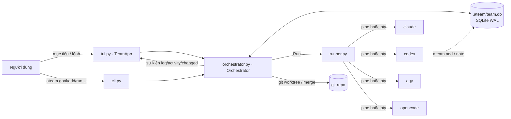
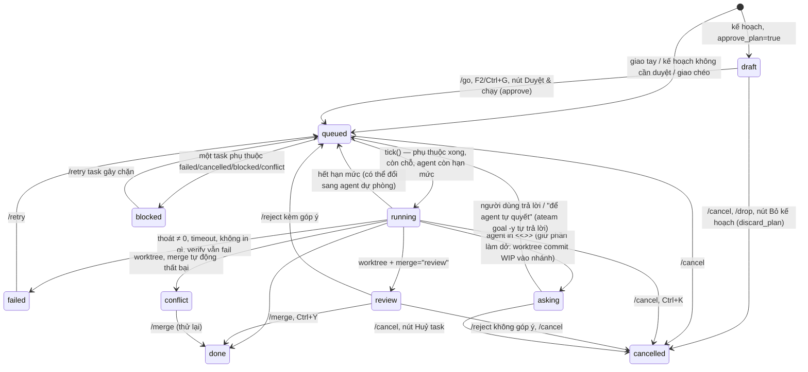

# Kiến trúc ateam

Tài liệu này mô tả ateam chạy thế nào ở mức đủ để sửa code an toàn. Tên hàm/biến khớp với code ở
phiên bản 0.3.1; nếu thấy lệch, code là chuẩn và hãy sửa tài liệu này.

## Tổng quan

- **Một vòng lặp asyncio** duy nhất (của Textual khi chạy TUI, hoặc `asyncio.run` trong CLI) chạy
  `Orchestrator.run_forever()` / `run_until_idle()`, mỗi ~0,5–0,7 giây gọi `tick()`.
- **DB là nguồn sự thật.** Trạng thái task chỉ đổi qua `DB.update_task`. TUI đọc lại DB mỗi 0,5 giây
  nên thấy cả thay đổi từ tiến trình khác (vd agent gọi `ateam add`). SQLite chạy WAL +
  `busy_timeout` để nhiều tiến trình ghi được.
- **Agent là tiến trình con** chạy headless; ateam không gọi API mô hình nào trực tiếp.

## Thực thể và trạng thái

### Task (`tasks`)

Cột đáng chú ý: `depends_on` (JSON list id), `depth` (số tầng giao chéo), `source`
(`user` | `plan` | `review` | `followup` | `cli` | `delegate:<agent>`), `model`/`effort` (ghi đè riêng task),
`branch`/`base`/`head` (worktree, dùng cho diff), `attempts` (số lần sửa sau khi verify fail),
`result` (SUMMARY đã bóc), `error`, `session`/`session_agent` (id phiên CLI của lượt gần nhất — `--resume`),
`resume` (prompt ngắn gửi khi tiếp tục phiên: lý do `/retry`, góp ý, câu trả lời, yêu cầu `/continue`; xoá khi chạy),
`ask` (JSON `{"qa": [{q, why, options, rec, a}], "parked"}` — câu hỏi `<<<ASK>>>`). `goals.lead_session`: phiên
trưởng nhóm lúc lập kế hoạch, `/continue m<id>` tiếp tục nó.

Giữ phiên: `AgentConfig.argv(session=, resume=)` thêm `session_args` (lượt mới, ateam tự sinh uuid) hoặc
`resume_args` (+ `apply_resume`: codex đổi sang `exec resume`, `--sandbox` → `-c sandbox_mode=`); preset theo binary
ở `config.SESSION_PRESETS`. `_run_agent` lưu id (tự đặt hoặc bắt bằng `session_re`) khi agent là agent của task;
gặp `SESSION_LOST_RE` lúc resume thì chạy lại với prompt đầy đủ. `usage_logs.collect(session=)` chọn đúng file phiên
(codex: lấy hiệu tổng token so với trước lượt).

Hằng số trạng thái ở đầu `db.py`; `ACTIVE = (draft, queued, running, review)` — mục tiêu chưa
được review khi còn task ở các trạng thái này.

### Mục tiêu (`goals`)

(`grilling` →) `planning` → `awaiting` (có task nháp chờ /go) hoặc `running` → `reviewing` → `done` |
`incomplete` | quay lại `awaiting`/`running` với `round + 1` nếu review giao thêm việc. `failed` khi
không lập được kế hoạch. `cancelled` khi người dùng bỏ kế hoạch nháp (`discard_plan`). Khi có mục
tiêu `awaiting`, TUI hiện `PlanBar` (`#plan`, nằm ngoài các tab) cho mục tiêu chờ lâu nhất và chuyển
focus vào nút duyệt nếu ô nhập đang trống. Mục tiêu tạo từ workflow (`run_workflow`, cột `workflow`) bỏ qua `planning`:
các bước chèn thẳng qua `_insert_plan(from_user=True)` (giữ effort/model của bước); `workflow.review`
(nếu đặt) thay `auto_review` khi `_check_goals` quyết định có review không. Task giao tay (`/task`, `ateam add` ngoài agent) không thuộc mục tiêu nào
nên không được review.
Review (`_review`) tiếp tục phiên CLI của lượt lập kế hoạch (`keep_session`, `goal.lead_session`); vòng cuối
(`round >= max_rounds`) báo trưởng nhóm không viết task mới (`review_prompt(final=True)`).

**Hỏi đáp trước** (`/grill`, "grill me"): `start_grill` tạo mục tiêu ở trạng thái `grilling`, cột `grill`
(JSON `{"qa": [{"q", "why", "options", "rec", "a"}], "spec", "error", "from_plan"?, "closed"?}`; câu đang chờ /
đã trả lời: `Goal.question()` / `Goal.answered()`, như `Task.question()`). Mỗi lượt `_grill_step` gửi `grill_prompt`
(mục tiêu + các cặp hỏi–đáp đã có) qua `_call_lead(keep_session=True)`: tiếp phiên trưởng nhóm của mục tiêu nên không
khám phá lại dự án mỗi câu, và `_plan` sau đó tiếp đúng phiên này; lịch sử vẫn nằm trong prompt nên mất phiên / CLI
không resume được vẫn chạy. Trưởng nhóm trả object JSON: `{"question", "why", "options", "recommended"}` (chuẩn hoá
bằng `prompts.question_from`, dùng chung với `<<<ASK>>>`; thêm câu hỏi, `a = null`, chờ người dùng) hoặc
`{"done": true, "spec"}` → lưu `spec`, `closed`, `planning`, `_plan` ngay (`lead_busy` giữ suốt). `answer_grill`
điền `a` (số 1…n = phương án — `pick_option`, cả `answer_task`; `None` = "để trưởng nhóm tự quyết" →
`prompts.skip_answer(rec)`) rồi hỏi tiếp; `finish_grill` gửi `finish=True` ("STOP the interview", bỏ câu chưa trả
lời); quá `GRILL_MAX` (15) câu cũng vậy. Không có `spec` thì dùng chính các cặp hỏi–đáp; chốt mà chưa trả lời câu
nào thì lập kế hoạch với mục tiêu gốc. `closed` = đã chốt: `_plan` không hỏi lại. Lượt không ra câu hỏi/đặc tả (JSON
hỏng, không còn trưởng nhóm nào chạy được, `AttachmentError`, lỗi khác) → `_grill_error` ghi `error`, khung hỏi đáp
hiện nút "↻ Hỏi tiếp" (`retry_grill`). `cancel_grill` dừng luôn lượt trưởng nhóm đang chạy (`lead_runs`).
`grill_command` bóc `/grill xong|bỏ|tiếp` cho TUI và web. `Goal.base_text()` = text + `CLARIFIED REQUIREMENTS:` +
spec, dùng cho mọi prompt lập kế hoạch/review (qua `full_text()`). Khung hỏi đáp (TUI `GrillBar`, web
`renderGrill`/`renderAsk`) vẽ theo `Orchestrator.waiting_view()`: câu `/grill` đang chờ trả lời > câu `<<<ASK>>>`
của agent > trạng thái `/grill` (đang nghĩ / lỗi) — một `/grill` bỏ dở không che câu hỏi của agent; khi đang chờ trả
lời, câu gõ ở ô nhập (không bắt đầu bằng `/` `!`) là câu trả lời. Mở lại app khi trưởng nhóm đang nghĩ: `setup()`
ghi `error`, người dùng bấm "↻ Hỏi tiếp".

**Hỏi lại khi lập kế hoạch**: `plan_prompt(can_ask=True)` (mục tiêu mới, chưa có `spec`, không `auto_answer`) cho
trưởng nhóm trả `{"question", …}` (`QUESTION_SCHEMA`, như `/grill`) thay cho mảng task khi có điểm quan trọng chưa
rõ. `_plan` thấy câu hỏi → `grill = {"qa": [câu đó], "from_plan": true}`, trạng thái `planning` → `grilling` (notify
báo "❓ Trưởng nhóm hỏi bạn"), rồi đi đúng luồng `/grill`: trả lời → `_grill_step` hỏi tiếp hoặc chốt `spec` → `_plan`
lại, lần này đã `closed` nên không được hỏi nữa. Câu hỏi bắt nguồn từ lúc lập kế hoạch (`from_plan`) dùng
`grill_prompt(essential_only=True)`: chỉ hỏi tiếp điểm thiết yếu, tối đa `PLAN_ASK_MAX` (3) câu — người dùng không gọi
`/grill` nên không phỏng vấn cả cây thiết kế.

**Tiếp tục** (`/continue`, F6, nút "↪ Tiếp tục", `ateam continue`): `continue_goal` mở lại mục tiêu đã
kết thúc (`GOAL_ENDED`) → `planning` với `round = 1` (giới hạn `max_rounds` tính lại), yêu cầu mới thêm vào
cột `followups` (JSON list; `Goal.full_text()` ghép `FOLLOW-UP n:` để gửi agent). `_plan(followup=…)` dùng
`followup_plan_prompt` kèm kết quả các task cũ (`_results_text`, dùng chung với review) và đánh giá trước;
task mới có `source = "followup"`. `continue_ref` bóc `m12` (mục tiêu) / `t40` (task; task thuộc mục tiêu
thì là mục tiêu đó); task không thuộc mục tiêu thì `continue_task` tạo task mới cùng agent/model/effort.

### Khác

- `notes`: ghi chú chung; 15 ghi chú mới nhất được chèn vào prompt mọi task sau, tính từ ghi chú
  `author = "compact"` mới nhất. `/compact` (`Orchestrator.compact`) gửi ghi chú + mục tiêu từ lần thu gọn
  trước + 60 dòng cuối `system.log` cho trưởng nhóm (`compact_prompt`), lấy phần sau `SUMMARY:` làm ghi
  chú `compact` mới; ghi chú cũ vẫn nằm trong DB nhưng không còn vào prompt.
- `runs`: mỗi lượt gọi agent/test một dòng (`kind` = `task` | `fix` | `lead` | `test`, `status` =
  `ok` | `failed` | `timeout` | `empty` | `ratelimit` | `cancelled`), dùng cho `/usage` và dashboard. Cột
  `goal_id` (lượt lập kế hoạch/review/hỏi đáp của trưởng nhóm), `cwd`, `model`; sau mỗi lượt
  `Orchestrator._collect_usage` (chạy nền, `run_until_idle` chờ xong) điền `in_tok/out_tok/cache_read/cache_write/
  cost/tok_src`: `usage_logs.collect` đọc file phiên Claude Code (`~/.claude/projects/<cwd mã hoá>/*.jsonl`, gộp
  dòng cùng `message.id`) hoặc Codex (`~/.codex/sessions/…`, `token_count` cuối), ghép theo thư mục + khoảng thời
  gian + đầu prompt → `tok_src = "cli"`; không có thì ước tính ~4 ký tự/token (`"estimate"`). `reports.dashboard` /
  `goal_history` cộng dồn cho tab 📊 Thống kê, trang web và `/usage`.
- Thông báo (`notify.Watcher`): TUI mỗi lượt `refresh_view`, web mỗi lượt đẩy ảnh chụp, so trạng thái task/mục
  tiêu với lần trước; chuyển vào `failed`/`conflict`/`review`/`asking`, mục tiêu `awaiting` hoặc kết thúc
  (`done` / `incomplete`·`failed`) → toast + chuông + `notify.desktop` (osascript / notify-send) ở TUI,
  `{"t": "notice"}` qua WS ở web (trình duyệt hiện Notification khi tab ẩn, phát âm Web Audio theo `kind` —
  `SOUNDS` trong `app.js`, âm lượng ở localStorage `ateam-sound`). Lần đọc đầu chỉ ghi nhận.

## Vòng đời một mục tiêu

1. `new_goal(text)` → `_plan(gid)` gọi `_call_lead(plan_prompt)`.
2. `_call_lead` thử trưởng nhóm rồi lần lượt `cfg.lead_fallback`, bỏ qua agent đang cooldown; một lượt
   chạy là `_lead_once` (ghi `logs/lead.log`, `lead_spans` cho timeline).
3. `extract_json(out, list)` → `_insert_plan`: agent lạ thì giao cho trưởng nhóm; `effort` chỉ nhận
   nếu nằm trong `efforts` của agent và `lead_sets_effort`; map id cục bộ → id DB cho `depends_on`.
4. Task ở `draft` (chờ `approve`) hoặc `queued`.
5. `tick()` chạy task; khi mọi task của mục tiêu ra khỏi `ACTIVE`, `_check_goals` gọi `_review`
   (nếu `auto_review`) → JSON `{done, summary, new_tasks}` → kết thúc hoặc thêm vòng (tối đa `max_rounds`).

## `tick()` — luật lập lịch

Với mỗi task `queued` theo thứ tự id:

1. Agent không còn trong cấu hình → `failed`.
2. Có phụ thuộc lỗi (`failed`/`cancelled`/`blocked`/`conflict`/mất) → `blocked`.
3. Còn phụ thuộc chưa `done` → chờ (kể cả phụ thuộc đang `review`).
4. `paused` hoặc đã đủ `max_parallel` → chờ.
5. Agent đang cooldown → chuyển sang `pick_fallback(agent)` nếu có, không thì chờ.
6. Agent đã chạy đủ `max_concurrent` → chờ.
7. Chưa cài lệnh → `failed`.
8. Đặt `running` *ngay* (chống chạy trùng), `self.runs[tid] = None`, spawn `_run_task`.

`is_idle()` (dùng cho `ateam run`/`goal`): không có gì đang chạy, trưởng nhóm rảnh, và mọi task
`queued` còn lại đều chỉ đang chờ hạn mức hồi hoặc chờ người duyệt — để lệnh headless không treo.

## `_run_task(tid)` từng bước

1. Worktree (nếu bật): `_wt_prepare` tạo `.ateam/worktrees/t<id>` trên nhánh `ateam/t<id>` từ HEAD,
   lưu `base`.
2. Dựng prompt (`task_prompt`): mục tiêu, task, SUMMARY của task phụ thuộc, ghi chú chung, luật
   DELEGATE/NOTE/SUMMARY (chỉ cho giao chéo nếu `depth < max_delegation_depth`). Riêng task giao tay
   bằng `/task` (`source = "user"`) gửi nguyên văn `prompt` người dùng gõ, không bọc gì (vẫn đổi `@file`
   trong `argv_for`); không có DELEGATE/NOTE, `result` lấy đoạn cuối output nếu agent không in `SUMMARY:`.
   Task hỏi tiếp thread (`source = "followup"`, không thuộc mục tiêu, `parent_id` = lượt trước) dùng
   `thread_prompt`: tối đa 6 lượt trước (prompt + result, đi ngược `parent_id`) rồi yêu cầu mới.
3. Nếu có verify và `only_when_changed`: lấy `_fingerprint` (HEAD + `git diff HEAD` + file chưa track).
4. `_run_agent(kind="task")` → `Run` → phân loại `_classify`: cancelled / timeout / ratelimit / failed
   / empty / ok.
5. `ratelimit`: `_set_cooldown`, chọn agent dự phòng, task quay về `queued`.
6. Vòng verify: nếu không đổi file thì bỏ qua; chạy `/bin/sh -c <command>` trong thư mục task;
   fail thì `fix_prompt` (kèm 120 dòng cuối) cho `fix_agent` hoặc chính agent đó, tối đa
   `max_fix_attempts`.
7. Ghi NOTE vào `notes`; SUMMARY của lượt đầu (+ tóm tắt lượt sửa) vào `result`.
8. Worktree: `_wt_finish` commit nhánh, xoá worktree, rồi merge tự động (`--no-ff`, có khoá
   `_merge_lock`) hoặc để `review`. Nhánh rỗng bị xoá; nhánh lỗi được giữ để xem.
9. `done` → `_delegations` tạo task cho các khối DELEGATE (tối đa 5/task). Ở chế độ review, việc này
   hoãn tới lúc `/merge` (đọc lại từ log task).

## Chạy tiến trình (`runner.Run`)

- `stdin` là `/dev/null` (hoặc pty), `start_new_session=True` để huỷ cả cây tiến trình bằng
  `killpg` (SIGTERM, 5 giây sau SIGKILL).
- `pty=True`: mở pseudo-terminal 220×50 — cần cho `agy`, vốn không in gì khi stdout không phải tty.
- Mỗi dòng qua `clean_line`: bỏ mã ANSI, xử lý `\r` (spinner), bỏ ký tự điều khiển.
- Timeout bằng `asyncio.wait_for`; mã 124 khi quá giờ.

## Dựng lệnh agent (`AgentConfig.argv`)

`command` chứa `{prompt}` (không có thì prompt được nối cuối). Nếu có model/effort và `command` không
tự chứa `{model}`/`{effort}`, `model_args`/`effort_args` được chèn **ngay trước** phần tử chứa
`{prompt}` — hoặc trước `-p`/`--print`/`--prompt` nếu cờ đó đứng ngay trước prompt (vài CLI dùng Go
`flag`, dừng đọc cờ ở đối số vị trí đầu tiên). Placeholder rỗng bị bỏ cùng cờ đứng trước nó.
Thứ tự ưu tiên: model/effort riêng task > `state.json` (đặt trong app) > file cấu hình > mặc định CLI.

## Nhắc file bằng `@` (`mentions.py`)

Dạng chung trong prompt (người dùng gõ, TUI chèn, trưởng nhóm có thể chép vào task): `@đường/dẫn`,
có dấu cách thì `@"đường dẫn"`. `Orchestrator.argv_for` gọi `mentions.render` ngay trước khi chạy
agent (cả lượt trưởng nhóm lẫn task/sửa lỗi): mỗi lần nhắc mà đường dẫn có thật (so với thư mục
task, rồi gốc dự án) được viết lại theo `file_ref` của agent, và `file_args` (vd `-f <path>` của
OpenCode) được chèn trước prompt bằng `mentions.insert_args`. DB luôn giữ dạng chung, nên đổi người
làm (`/assign`, dự phòng hạn mức) vẫn ra đúng cú pháp của người mới.

TUI: `CommandInput` (con của `Input`) dò `@…` ngay trước con trỏ ở mỗi `Input.Changed`, lọc
`FileIndex` (`git ls-files -co --exclude-standard`, không phải repo git thì `os.walk` bỏ thư mục rác;
làm mới tối đa 20 giây/lần, chạy bất đồng bộ) và hiện `MentionList` (OptionList nổi trên lớp
`overlay`). Khi danh sách mở, ↑↓/Tab/Enter/Esc thuộc về nó; khi đóng, Enter gửi lệnh và Tab chuyển
focus như cũ.

### Ảnh (`clipboard.py`)

Terminal không gửi ảnh khi dán (Cmd+V chỉ có chữ), nên Ctrl+V trong `CommandInput` (đè `paste` của
`Input`) gọi `clipboard.grab_image`: macOS dùng `pngpaste` nếu có, không thì `osascript` (PNG trong
clipboard, hoặc file ảnh copy từ Finder thì dùng thẳng file đó); Linux dùng `wl-paste`/`xclip`. Ảnh lưu
ở `.ateam/images/paste-<giờ>.png` (xoá ảnh cũ hơn 7 ngày) rồi chèn `@.ateam/images/…` vào ô nhập.
Không có ảnh thì dán chữ trong clipboard nội bộ của Textual như Ctrl+V cũ, hoặc báo lý do. Kéo-thả
file ảnh vào terminal là một sự kiện `Paste` chứa đường dẫn (thoát dấu cách bằng `\` hoặc trong nháy):
`_on_paste` đổi thành `@ảnh`.

Từ đó ảnh đi đúng đường `@file`. `render` dùng `image_args` (mặc định `mentions.IMAGE_ARGS`; vắng thì
như `file_args`) thay `file_args` cho đường dẫn có đuôi ảnh: Codex nhận `--image=<path>` (dạng có `=`
vì `-i` nhận nhiều giá trị, sẽ nuốt luôn prompt), OpenCode `-f`, Claude/agy đọc `@path` trong prompt.
Đường dẫn tương đối không có trong thư mục làm việc (worktree không có `.ateam/`, vì git bỏ qua) nhưng
có ở gốc dự án được đổi sang tuyệt đối.

## Hạn mức

`limits.looks_rate_limited(output, rc)` chỉ xét khi agent thất bại hoặc in ≤ 15 dòng (tránh nhầm
với code nói về "rate limit"), tìm mẫu trong 30 dòng cuối. `reset_time` đọc giờ hồi từ
`|<epoch>` (Claude), `try again in N minutes`, `resets at 3pm`; không có thì `cooldown_minutes`.
Cooldown lưu ở `~/.config/ateam/state.json` (`cooldown`), dùng chung mọi dự án.

## Chat trực tiếp với agent

`Orchestrator.chat(agent, text, new=False)` tạo task `source="chat"` (`CHAT`), `parent_id` = lượt chat trước của
agent đó (`chat_last`); lượt trước có phiên cùng agent thì đặt `session` + `resume=text` như `/continue t<id>`, nên
`_run_agent` chạy `--resume` chỉ với tin mới (mất phiên → `thread_prompt` với `thread_of`, đi ngược chuỗi `followup`
và `chat`). Mỗi agent một lượt chat một lúc. Khác task thường: `tick()` không chờ `paused`/`max_parallel`/
`max_concurrent`, không đổi sang agent dự phòng (đang hết hạn mức → FAILED kèm lời nhắn); `_run_task` chạy ở thư
mục gốc (không worktree), không verify, không `<<<ASK>>>`, không DELEGATE, kết quả = `extract_summary(…, 12000)`.
Bảng việc (TUI `_refresh_table`, web `boardTasks()`), `finished_ids` (/clear) và gợi ý /continue bỏ qua task chat.
`chat_reset(agent)` / `/new`: tin kế tiếp không nối phiên cũ.

"Mở trong terminal": `AgentConfig.interactive_argv(session)` (`INTERACTIVE_RESUME` ở `config.py`: `claude --resume`,
`codex resume`, `grok --resume`; CLI khác mở trơn; agent tuỳ chỉnh → None), phiên lấy từ
`Orchestrator.terminal_session` (lượt chat gần nhất — CLI tìm phiên theo thư mục, nên không lấy phiên của worktree).
TUI: `App.suspend()` + `asyncio.create_subprocess_exec` (vòng lặp vẫn chạy, Textual chỉ ngừng đọc phím/vẽ; SIGINT
tạm gắn handler rỗng để Ctrl+C lọt ra không giết ateam). Web: `pty_session.PtySession` — pty có kích thước, pty là
terminal điều khiển (`TIOCSCTTY` sau `setsid`) để đổi kích thước phát SIGWINCH, byte thô hai chiều; op WebSocket
`pty_open|pty_in|pty_resize|pty_close` (chặn ở `--readonly`), output tin `pty` (base64) chỉ gửi tab đã mở, `pty_exit`
khi thoát; tab đóng / server tắt thì đóng hết. Trình duyệt: `xterm.js` + addon fit ở `webui/vendor/` (chép từ
`scripts/editor`, `npm run term`), nạp khi mở lần đầu.

## Lưới terminal (tab 🔲 Lưới, `/grid`)

Mỗi ô là CLI tương tác thật của một agent (`AgentConfig.interactive_argv(session, model=, effort=)`; agent tuỳ chỉnh
không có chế độ tương tác nên không thêm được). `grid.py`:
- `Layout` = danh sách `Column` (độ rộng tương đối `w`), mỗi cột nhiều `Cell` (độ cao tương đối `h`). `move(src, dst,
  where)` với `where ∈ WHERE` (`center` đổi chỗ, `left/right` cột mới cạnh ô đích, `top/bottom` chèn vào cột đích);
  `apply(preset)` xếp lại theo `PRESET_SHAPES` (stack, cols2, auto, lead, row). Lưu `.ateam/grid.json` (ghi atomic)
  — mở lại ateam thì ô hiện "chưa mở", Enter/⟲ mới chạy CLI (tiếp tục phiên nếu `resume`).
- `GridHub` dùng chung TUI ↔ web: mỗi ô một `PtySession` + buffer output (256KB) để vẽ lại khi màn hình/tab mới
  gắn vào; `write` với ô `bcast` thì gửi cho mọi ô bật "gửi tất cả"; sự kiện `data|exit|layout` qua `listen()`.
- TUI (`tui_grid.py`): `TermView` vẽ `vterm.Screen` (giả lập VT100/xterm thuần Python: CSI/SGR/OSC, alt screen,
  scroll region, ký tự rộng, lịch sử cuộn) bằng `render_line`, làm mới 30fps khi `Screen.version` đổi; phím →
  `vterm.encode`. Khi ô đang focus, `App.check_action` trả False cho mọi binding Ctrl (trừ thoát) để Ctrl+C/Ctrl+R…
  tới CLI. F10 = chế độ sắp xếp bằng phím; kéo tiêu đề ô (`GridHead`) thả lên ô khác, vùng thả theo mép 25%.
- Web: op `grid_attach|add|start|in|size|close|move|preset|sizes|bcast|cell` (chỉ `grid_attach` được ở
  `--readonly`); tin `grid` (bố cục + trạng thái), `gpty` (base64), `gpty_exit`. `grid.js` giữ một xterm mỗi ô qua
  các lần dựng lại, kéo thả HTML5 tiêu đề ô, kéo khe đổi `w`/`h` (`grid_sizes`).

## Lệnh terminal (`!lệnh`)

`shell.ShellManager` (một instance trong `TeamApp`, tách khỏi Orchestrator — lệnh của người dùng không phải
task): mỗi `!lệnh` là một `ShellJob` chạy `$SHELL -lc <lệnh>` qua `Run(use_pty=True, timeout=10 ngày)` trong
thư mục dự án, ghi `.ateam/logs/sh<id>.log`, giữ 5000 dòng cuối trong bộ nhớ, bắt port bằng `PORT_RE`.
Sự kiện `on_event("line"|"exit"|"changed", job, line)` → `TeamApp.on_shell_event` vẽ tab Terminal (`#jobs`,
`#job-log` qua `LogStyler(task_headers=False)`). `action_quit` gọi `stop_all()` (killpg) trước khi thoát.
Gợi ý `!` (`CommandInput` chế độ `shell`) lấy từ `shell.project_scripts`; lệnh gần đây ở `recent_commands`
trong `.ateam/state.json` của dự án. Enter chạy lệnh đã gõ, chỉ chạy gợi ý khi ô trống hoặc đã ↑↓ chọn.

## Quản lý git (tab 🌿 Git)

`gitops.GitRepo` (một instance trong `TeamApp`, không phụ thuộc Textual): mọi lệnh chạy qua
`asyncio.create_subprocess_exec("git", "-c", "core.quotePath=false", …)` với `GIT_TERMINAL_PROMPT=0` (không bao giờ
hỏi mật khẩu trong TUI — sẽ treo), `GIT_EDITOR=true`, `LANGUAGE=C` (thông báo tiếng Anh ổn định để dò `CONFLICT`,
`rejected`…), timeout 30 giây (fetch/pull/push 120 giây). `commit(no_verify=True)` thêm `--no-verify`; commit lỗi mà repo có hook (`has_commit_hooks`: thư mục hooks hoặc
`core.hooksPath` của husky) thì lời nhắn gợi ý ô *Bỏ qua hook*. Thao tác thay đổi repo giữ `GitRepo.lock`; commit/merge/
stash/revert có cờ `-c user.*` dự phòng như `Orchestrator.git_ident`. Mỗi hàm trả `(ok, lời nhắn tiếng Việt)`.

- Trạng thái: `git status --porcelain=v2 --branch --show-stash -z --untracked-files=all` → `parse_status` →
  `RepoStatus` (nhánh, upstream, ahead/behind, file theo nhóm đã stage / chưa stage / chưa theo dõi / xung đột,
  số stash) + `_op_state()` đọc `MERGE_HEAD`/`rebase-*`/`CHERRY_PICK_HEAD`/`REVERT_HEAD` (`git rev-parse --git-path`).
- Xung đột: `parse_conflicts`/`resolve_conflict_text` (khối `<<<<<<<`, cả diff3 `|||||||`), `conflict_info` (khối +
  ngữ cảnh, phía nào xoá file), `resolve_block` (hết khối → `mark_resolved` = `add -A`), `take_side` (`checkout
  --ours/--theirs` + add, phía đã xoá → `rm`), `continue_op` (`commit --no-edit` / `<state> --continue`; `run` luôn
  đặt `GIT_EDITOR=true`). Nhờ agent: `Orchestrator.resolve_conflicts` → lượt chat mới (`conflict_prompt`) với
  `commit_agent()`. UI: `ConflictScreen` (TUI), `GitView.resolve` + `/api/git/conflict` (web).
- Pull: `--ff-only`, hai bên đã rẽ nhánh thì `--no-rebase` (merge; không viết lại lịch sử). Push lần đầu tự
  `-u <origin|remote đầu tiên> <nhánh>`; `/push -f` = `--force-with-lease`. Checkout `origin/x` tạo nhánh local
  theo dõi. "Bỏ commit cuối" = `reset --soft HEAD~1`, chặn khi commit đã có trên upstream (dùng Revert).
- Diff: `changes_diffset(staged)` / `commit_diffset(commit)` dựng `DiffSet` cho `DiffScreen` (tid 0). Quy ước
  `base`/`head` của `diff_versions`: `""` = index (`git show :path`), `None` = file trong thư mục,
  commit đầu tiên so với cây rỗng `EMPTY_TREE`.
- Commit message: `Orchestrator.commit_message()` gửi `prompts.commit_message_prompt` (diff đã stage, không có
  thì mọi thay đổi; 8 commit gần nhất để bắt chước ngôn ngữ/kiểu) qua `_call_lead` (có dự phòng hạn mức), bóc
  bằng `extract_commit_message` (sau `SUMMARY:` cuối). Ô nhập một dòng giữ tiêu đề; phần thân lưu ở
  `TeamApp._git_body` và được nối vào khi commit.
- TUI: `refresh_git()` đọc status + 80 commit, vẽ khi mở tab, sau mỗi thao tác (`git_do`), và mỗi 3 giây khi tab
  đang mở (agent/editor ngoài sửa file). Danh sách file chỉ dựng lại khi danh sách id đổi, con trỏ đi theo file khi
  nó chuyển nhóm. Thao tác đổi HEAD (checkout, tạo nhánh, pull, merge, stash, revert, bỏ commit) bị từ chối khi
  `orch.runs` khác rỗng — agent đang sửa thư mục hoặc sắp merge nhánh task vào nhánh hiện tại. Thao tác không
  hoàn tác được (bỏ thay đổi, xoá hẳn nhánh, xoá stash, revert, bỏ commit) hỏi lại bằng `ConfirmScreen`.
  `/git <lệnh>` chạy `git <lệnh>` qua `ShellManager` (tab Terminal) cho các việc còn lại (rebase, tag…).

## Tab 📝 Code (`editor.py` + `CodeEditor`)

- `editor.py` không phụ thuộc Textual: `read_source`/`save_source` (gọi qua `asyncio.to_thread`; từ chối file
  nhị phân, giữ CRLF/BOM, ghi qua file tạm + `os.replace`, trả `"conflict"` khi mtime trên đĩa khác lúc mở),
  `highlight_lines` (pygments → `{dòng: [(byte_đầu, byte_cuối, tên style)]}` — **offset byte UTF-8** vì
  `TextArea._render_line` đọc theo byte), `VimState.feed(phím, ký tự, dòng, con trỏ, cao)` trả danh sách thao
  tác (`move`/`move_v`/`edit`/`select`/`undo`/`redo`/`mode`/`ex`/`msg`) — test bằng `apply_ops`, không cần app.
- `CodeEditor(TextArea)` ở `tui.py`: ở normal/visual `_on_key` đưa phím vào `VimState` rồi `apply`;
  `check_action` chặn binding sửa chữ của TextArea (Ctrl+U/K/W…) và `check_consume_key` chỉ nhận ký tự in được
  (để Ctrl+T, F1, Ctrl+Q của app vẫn chạy); `TeamApp.check_action` nhường Ctrl+D/R/K/G/O/Y/L cho editor khi
  nó đang focus. Lệnh `:` gọi `TeamApp.code_ex`.
- Hiệu năng: `_build_highlight_map` (Textual gọi sau mỗi lần sửa) chỉ hẹn tô lại sau 0,2 s trong thread
  worker (`exclusive`, bỏ kết quả cũ theo `_gen`), chỉ tới hết màn hình + 200 dòng, cuộn xuống thì tô tiếp.
  Vá hai chỗ O(n) mỗi khung hình/mỗi phím của Textual: `WrappedDocument.height` (`_NoWrapDocument`) và
  `_refresh_size` (giữ độ rộng lớn nhất, chỉ đo dòng vừa sửa). `refresh_view` ở tab Code chỉ kiểm tra mtime
  file đang mở mỗi 2 s.
- Buffer: `TeamApp.code_bufs` (tối đa 10, bỏ buffer cũ nhất đã lưu), giữ con trỏ và nội dung chưa lưu khi đổi
  file (lịch sử undo mất khi đổi buffer).
- Command palette (`palette.py`, dùng chung TUI ↔ web): `CODE_COMMANDS` (id, nhãn, phím) + `KEYWORDS` tiếng Anh
  để lọc mờ (`fuzzy`, ưu tiên khớp đầu từ); `symbols()` bóc hàm/class/heading bằng token pygments (`Name.Function`,
  `Name.Class`), JS/TS và ngôn ngữ lexer không gắn tên thì bằng regex; file gần đây ở `.ateam/state.json`
  (`recent_files`, ghi khi mở file ở TUI hoặc `GET /api/file` không có `quiet`); `file_new`/`file_rename`/
  `file_trash` (qua `safe_path`, Thùng rác của Finder trên macOS, `ATEAM_TRASH_DIR` cho test). TUI: `PaletteScreen`
  hỏi `TeamApp.palette_items(chữ)`, chạy lệnh bằng `code_command(id)`. Web: `CodeView.palette()` trong `code.js`,
  API `/api/symbols`, `/api/recent`, op `file_new|file_rename|file_delete|open_vscode`, diff `kind=file`.

## Rule của dự án (`/rules`)

`rules.py`: lưu ngoài repo (`config.GLOBAL_DIR/rules/`, cùng tên file với to-do), `apply(action)` thêm/sửa/bật-tắt/
xoá/đổi thứ tự, `applies(rule, agent, role, lead)` chọn người nhận, `block()` khối "PROJECT RULES" tiếng Anh bọc
nội dung người dùng viết. Điểm gắn duy nhất: `Orchestrator.argv_for` → `with_rules` đặt khối rule trước *mọi* prompt
(task, `/task` và chat gửi nguyên văn, lượt trưởng nhóm qua `_lead_once` với `plan=True` → `lead`), trước khi
`mentions.render` đổi `@file`. Lượt `--resume`: phiên đã có rule — `_rules_sent[session]` nhớ digest đã gửi, chỉ gửi lại
(kèm "updated") khi bộ rule đổi; phiên mở từ lần chạy app trước coi như đã có. `native_files()` liệt kê `AGENTS.md`,
`CLAUDE.md`… (`NATIVE`, kiểm trên CLI thật) chỉ để xem — không gửi kèm. TUI: `RulesScreen`, `RuleEditScreen`
(`TextAreaVN`: ô nhiều dòng gõ tiếng Việt như `TextInput`). Web: `rules.js`, op `rules` / `rules_list` (đọc được ở
`--readonly`).

## Mở folder / dự án khác (`/open`)

Mọi thứ (Orchestrator, DB, khoá phiên, cấu hình, `FileIndex`, `ShellManager`…) gắn với một `root`, nên đổi dự án là
**chạy lại tiến trình** với `-C <thư mục>` (`cli.with_root`), không đổi tại chỗ. `projects.py`: `recent_projects`
(`state.json` chung, `touch_project` khi mở TUI / web), `candidates(chữ)` (lọc dự án gần đây theo tên, hoặc thư
mục con khi gõ đường dẫn), `check_target` (tồn tại, là thư mục, ghi được, khác dự án đang mở, không bị phiên
khác khoá).
- TUI: `open_project` đặt `restart_root` + `restart_requested` rồi `action_quit` (hỏi file chưa lưu, huỷ lượt
  chạy) → `cli.cmd_tui` `execv` như `/lang`. Dưới `ateam web --tui` (WebDriver) không `execv` được → chỉ báo.
- Web: op `open_project` (agent đang chạy → trả `busy`, trình duyệt hỏi rồi gửi `force`) đặt `next_root` rồi
  `stop_server` (`GracefulExit`, như Ctrl+C: `_shutdown` dừng agent/lệnh terminal) → `serve()` trả `next_root`
  → `cli.cmd_web` `execv` cùng cổng (bỏ `--open`). File mở bằng `open()` không kế thừa qua `execv` nên khoá phiên
  cũ tự nhả. Trình duyệt kết nối lại, thấy `hello.root` khác thì `location.reload()`. Chặn khi `remote.enabled`.

## Xem diff

`Orchestrator.diff_files(tid)` chạy `git -c core.quotePath=false diff -M --no-color` (worktree: `base..head`
của task; shared: `HEAD` + file chưa track từ `git ls-files --others`, bỏ `.ateam/`, file > 1 MB) và
`diffview.parse_unified` bóc thành `FileDiff`/`Hunk`/`DiffLine` có số dòng cũ/mới. `DiffScreen` (`tui.py`)
vẽ từng file bằng `diffview.render`: hai cột ghép dòng xoá ↔ dòng thêm theo khối (`split_rows`), tô cú pháp
cả khối mỗi phía một lần rồi tách dòng, chữ đổi so theo từ (`word_spans`); tối đa 4000 dòng mỗi file.
Phím `o`: `diff_versions` ghi hai bản ra `.ateam/diff/t<id>/old|new/` (`git show`) rồi chạy `code --diff`.
`Orchestrator.diff()` dạng chữ vẫn dùng cho `ateam diff`.

## Giao tiếp với TUI

`Orchestrator.emit(kind, **data)` gọi `on_event` đồng bộ trong cùng vòng lặp:

| kind | data | TUI làm gì |
| --- | --- | --- |
| `log` | `task_id` (0 = hệ thống), `line`, `agent?`, `raw?` | ghi vào log đang xem và ô agent |
| `activity` | `agent`, `start` hoặc `end` (dict: task_id, title, label, started, lines, last_line, last_at, status) | vạch ▶/■ trong ô agent |
| `changed` | — | hẹn vẽ lại sau 150 ms (`schedule_refresh`: nhiều sự kiện liền nhau thành một lần vẽ) |

`self.activity[agent]` giữ các hoạt động đang chạy (nhiều nếu `max_concurrent > 1`); `lead_spans`
cho timeline. TUI chỉ đọc hai cấu trúc này, không sửa.

### Hiệu năng vẽ (TUI)

- `refresh_view` (mỗi 0,5 giây và sau `changed`) đọc DB **một lần** (`self._snap`: tasks, goals) cho mọi
  `_refresh_*` (cả `GrillBar`, `PlanBar`, `Timeline` qua `snap_tasks()/snap_goals()`; `db.usage` 5 giây một lần;
  dashboard chỉ dựng lại khi `DB.change_sig()` đổi); chỉ vẽ tab đang mở (bảng việc / Đội / Terminal; tab Git tự đọc lại git mỗi 3 giây), chuyển tab thì vẽ ngay
  (`on_tabbed_content_tab_activated`). `set_static()` chỉ gọi `Static.update` khi nội dung đổi.
- Lướt bảng: `RowHighlighted` đổi `view_task` + ô chi tiết ngay, còn nạp log hẹn 120 ms (chỉ dòng dừng lại).
  `show_task` đọc ~192 KB cuối file (`read_log_tail`) và hiện `LOG_SHOW_LINES` dòng cuối; `#detail` cao cố định
  để đổi task không làm tính lại bố cục cả màn hình.
- `ReflowLog` (ô agent tab Đội) khi chưa từng hiện chỉ giữ dòng trong `_items` (có giới hạn) thay vì hàng đợi hoãn
  không giới hạn của RichLog; vẽ một lần khi có kích thước.
- Bộ lập lịch: `tick()` đọc `DB.task_index()` (id → trạng thái, agent) một lần cho mọi phụ thuộc; `AgentConfig.installed()`
  dùng `config.which` nhớ 10 giây; `system.log` quá 5 MB thì đổi thành `system.log.1`.
- `animation_level = "none"`: không có hiệu ứng gạch chân tab trượt / cuộn mượt.
- `ReflowLog` (thay `RichLog`): giữ nội dung đã ghi, đổi bề rộng thì vẽ lại — RichLog vẽ dòng theo bề rộng lúc
  ghi, nên log ghi khi cột hẹp (1–2 ký tự) thành chữ dọc mãi. Dưới `NARROW_WIDTH` (110) cột, `#board` thêm
  class `narrow` và xếp dọc.

### Ngôn ngữ và theme

- `i18n.tr(vi, **kw)`: khoá là chuỗi tiếng Việt, tiếng Anh tra ở `locales/en.py`, thiếu thì dùng tiếng Việt.
  Ngôn ngữ chọn một lần lúc import `ateam.i18n` (`--lang` > `ATEAM_LANG` > `state.json` `lang` > đã có
  `state.json` → `vi` > `LANG`/`LC_ALL`). `/lang` lưu rồi đặt `restart_requested`; `cli.cmd_tui` `os.execv` lại
  tiến trình sau khi app thoát (từ chối tự mở lại khi agent đang chạy).
- `theme.py`: theme dựng sẵn của Textual + màu nhấn (`make_theme` thay `primary`/`accent`, tên `gốc+màu`).
  `TeamApp.apply_theme` đăng ký theme, gán `App.theme`, dựng lại bảng màu chữ Rich (`apply_palette`), đổi màu
  diff sáng/tối (`diffview.set_light`), lưu `theme`/`accent` vào `state.json`. `ThemeScreen` xem trước khi di
  chuyển, Esc trả theme cũ.
- `StatusBar` (`#statusbar`, dock dưới, cùng `#cmd` và Footer — đẩy nhau bằng margin): vẽ mỗi lượt
  `refresh_view`; ngoài tab Git đọc lại git status mỗi 10 giây cho nhánh ↑↓.

### Popup (`BaseModal`)

Mọi `ModalScreen` kế thừa `BaseModal`: dòng tiêu đề có nút ✕ (`title_bar`), Esc **không** dùng `priority` nên
dropdown `Select` / danh sách đang mở nhận Esc trước; form có `dirty()` (so với `mark_clean()` lúc mở) cần Esc
hai lần trong 3 giây. Nút dùng `Btn` (nhãn `[ … ]`, không nền/viền, variant = màu chữ — CSS trong `TeamApp.CSS`).

### Wizard thiết lập (`OnboardScreen`)

Lần đầu mở app / `/setup` / `ateam setup`. 7 bước, mỗi lúc chỉ mount widget của bước đang mở; `collect()` đọc
giá trị bước hiện tại vào thuộc tính, `show_step()` dựng bước mới. Bước vai trò dùng `config.ROLES`,
`default_cli`, `tier_preset` (mức chi phí → model theo từ khoá trong danh sách model thật + effort hợp lệ).
Kết quả: `plan_team(assign)` → `TeamPlan` (vai trò cùng CLI/model/effort gom một agent; nhóm sau của cùng CLI
thành agent `<agent>-<vai trò>`), rồi `save_onboard()` ghi `custom.toml` (agent thêm, `wizard = true`),
`state.json` (`save_setup` + `approve_plan`/`auto_review`) và `.ateam/state.json` (`isolation`, `merge`,
`verify_command`). Đổi `isolation` thì gọi `Orchestrator.apply_isolation()`.

## Môi trường truyền cho agent

`ATEAM_DB`, `ATEAM_ROOT`, `ATEAM_TASK_ID`, `ATEAM_AGENT` — để agent tự gọi `ateam add --to …`
(task con có `parent_id`, `depth + 1`, cùng mục tiêu) hoặc `ateam note "…"`.

## Giao diện web (`ateam web`)

`web.WebApp` (aiohttp) giữ **một** `Orchestrator` + `ShellManager` cho mọi tab trình duyệt; trang tĩnh ở
`ateam/webui/` (HTML/CSS/JS thuần, không build, không CDN): `app.js` (lõi: kết nối, bảng việc, Đội, Terminal, ô
nhập + gợi ý tham số, modal, theme), `diff.js`, `git.js`, `code.js`, `setup.js`; `vendor/codemirror.js` là CodeMirror 6
+ vim đóng gói sẵn (nạp khi mở tab Code). Server giữ khoá `acquire_session_lock` như TUI.

- `GET /ws` (WebSocket): server gửi `hello` (chuỗi giao diện `ui_strings()`, mọi lệnh của `tui.COMMANDS`, dữ liệu gợi ý
  — agent + model/effort hợp lệ, workflow, màu nhấn, tuỳ chọn), gửi lại khi cấu hình đổi (/setup, /custom, /models
  làm mới); `state` — ảnh chụp bảng việc (`snapshot()`), dựng lại mỗi 0,5 giây, chỉ gửi khi khác lần trước — task
  không mang `prompt`/`result` (trừ prompt của task nháp), ngăn chi tiết lấy qua `/api/task/<id>`; `live` — dòng cuối
  của task đang chạy (đổi liên tục nên tách khỏi `state`, để ảnh chụp lớn chỉ gửi khi bảng việc thật sự đổi);
  `lines` — dòng log task (`k: "log"`) và output lệnh `!` (`k: "job"`) gom `LOG_FLUSH` (0,1 giây) một lần; `prefs`,
  `discovered`; `toast` trả lời thao tác (`ref` để trình duyệt chờ kết quả, `open` để mở tab/khung/
  file). Trình duyệt gửi `{"op": …}` — xem `WebApp.handle`; ô nhập (`submit`) và lệnh `/…` cùng luật với TUI
  (`WebApp.command`, test đối chiếu mọi lệnh trong `tui.COMMANDS`).
- Trình duyệt vẽ Kanban bằng `patchList` (app.js): mỗi thẻ có chữ ký, chỉ dựng lại thẻ đổi — giữ hover/chọn chữ.
  `/api/dashboard`, `/api/goals` nhớ kết quả theo `DB.change_sig()` + phút hiện tại.
- Đọc: `/api/log/<task>`, `/api/task/<task>`, `/api/agent/<tên>`, `/api/job/<id>`, `/api/scripts`, `/api/files?q=`, `/api/continue?ref=`;
  Git (`web_git.py`, bọc `gitops.GitRepo`): `/api/git/status|log|branches|stashes|diff`, `/api/diff/<task>`
  (`orch.diff_files`) — diff gửi dạng `diffset_json` (dòng + token pygments + `word_spans` + `split_rows`); Code
  (`web_code.py`, `editor.read_source/save_source`): `/api/tree?dir=` (từ `FileIndex`), `/api/file`, `/api/file/stat`
  — `safe_path` chặn đường ra ngoài dự án và `.git`; /setup, /custom, tuỳ chọn (`web_setup.py`): `/api/setup*`,
  `/api/custom*`, `/api/prefs`.
- Logic dùng chung với TUI nằm ngoài Textual: `wizard.py` (giá trị khởi tạo/gán vai trò/cài đặt của wizard, kiểm tra
  form agent/workflow, áp cấu hình mới vào config đang chạy), `reports.py` (/usage, /agents, /flow, /models, gợi ý
  /continue). Tuỳ chọn `vim` và `accent` trong `state.json` dùng chung hai giao diện.
- `web_auth.auth_middleware` (`guard_middleware` ở chế độ cục bộ): Host phải là `127.0.0.1|localhost|[::1]:<port>`
  (chặn DNS rebinding), Origin nếu có cũng vậy (chặn trang lạ mở WebSocket). Áp cho cả `ateam web --tui`. Chế độ từ
  xa (`Remote.enabled`: `--host` khác loopback, `--tunnel`, `--public-url`): mọi request trừ `/static` và `/login`
  cần token (`?t=` → cookie `ateam_auth`, hoặc `Authorization: Bearer`), Origin phải trùng Host, sai 20 lần/10 phút
  → 429; `--readonly` chặn mọi op WebSocket trừ `READONLY_OPS`. `--tunnel` chạy `cloudflared tunnel --url` trong
  `_startup`, đọc URL `*.trycloudflare.com` từ stderr; `/api/remote` trả URL + mã QR (`qr.py`) cho nút 📱.
- Chữ hiển thị nằm ở `ui_strings()` (qua `tr()`, có bản dịch); JS chỉ dùng khoá — `tests/test_web.py` bắt chữ
  tiếng Việt viết thẳng trong JS/HTML (trừ `vendor/`).

`ateam web --tui` (`cli.cmd_web_tui`): `textual_serve.server.Server` chạy `python -m ateam -C <dự án> tui` cho mỗi
kết nối (biến `TEXTUAL_DRIVER=…WebDriver`, stdout là kênh giao thức — đừng `print` trong `cmd_tui`); phiên thứ hai
thấy `tui.BusyApp`; dưới web driver `/lang` chỉ thoát app (không `execv`). Xem DECISIONS #13.

## File trên đĩa

| Đường dẫn | Nội dung |
| --- | --- |
| `~/.config/ateam/config.toml` | cấu hình chung (tự tạo, tự nâng cấp theo `CONFIG_VERSION`) |
| `~/.config/ateam/state.json` | model/effort chọn trong app (`agents`), `cooldown` |
| `<dự án>/.ateam/config.toml` | ghi đè theo dự án (merge sâu lên file chung) |
| `<dự án>/.ateam/state.json` | `verify_command` đặt bằng `/verify` |
| `<dự án>/.ateam/team.db` | bảng việc |
| `<dự án>/.ateam/logs/` | `system.log`, `lead.log`, `t<id>.log` |
| `<dự án>/.ateam/grid.json` | bố cục tab 🔲 Lưới (ô, agent, model/effort, kích thước) |
| `<dự án>/.ateam/tui.lock` | khoá chỉ-1-phiên giao diện (flock, tự nhả khi tiến trình thoát) |
| `<dự án>/.ateam/worktrees/` | worktree tạm của task (chế độ worktree) |
| `<dự án>/.ateam/.gitignore` | `*` — cả thư mục không vào git |
| `~/.ateam/venv`, `~/.local/bin/ateam` | bản cài bằng `install.sh` |
